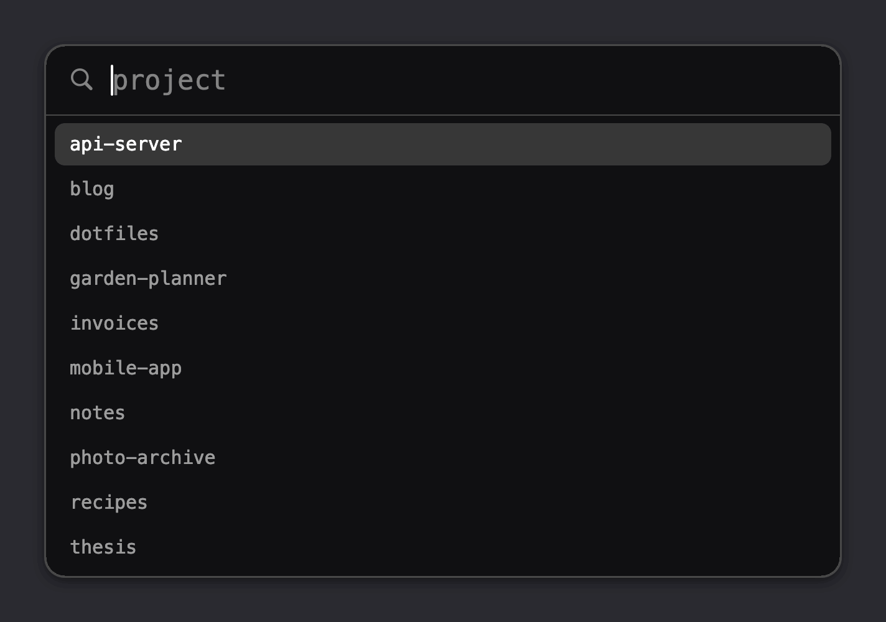

# StdMenu

A dmenu for macOS: it reads lines on stdin, lets you pick one in a small search window, and prints it
on stdout. Bound to global hotkeys, shell pipelines become app launchers, emoji pickers and anything
else. A resident agent keeps the window ready, so menus open instantly, and ranking is synchronous
and deterministic, so the same keys always choose the same item.

## Example

A project switcher is one line in `~/.config/stdmenu/config`:

    alt-p = ls ~/Projects | stdmenu -0 -p project | xargs -0 -I{} open -a Terminal ~/Projects/{}

## Install

Needs macOS 14 or later and the Command Line Tools with Swift 6 (`xcode-select --install`), not Xcode.

    make install    # ~/Applications/StdMenu.app, ~/.local/bin/stdmenu, a default config, starts at login
    make uninstall  # keeps ~/.config/stdmenu and the log

Change the locations with `make install APPDIR=… BINDIR=…`, and add `~/.local/bin` to your `PATH` to
use `stdmenu` in a terminal. The default config puts an app launcher on `alt-space` and an emoji picker
on `alt-shift-space`.

The agent is the launchd job `dev.schmaeke.stdmenu` and logs to `~/Library/Logs/stdmenu.log`. Restart
it with `launchctl kickstart -k gui/$(id -u)/dev.schmaeke.stdmenu`.

## Usage

    stdmenu [-0] [-p prompt] [-l lines] [-w width]  pick a line from stdin, print its value (exit 1 if cancelled)
    stdmenu -f query                                print the values of stdin ranked against query
    stdmenu --paste                                 paste stdin into the frontmost application
    stdmenu --reload                                reload the configuration and report problems
    stdmenu agent                                   run the agent

Input lines are `label<TAB>value<TAB>icon`. The label is shown and searched, the value is printed and
defaults to the label, and the optional icon is a single character such as an emoji, or the path of an
image or of a file or app whose icon to show. `-0` ends the value with a NUL byte for `xargs -0`, so
that spaces and quotes survive. Unlike in dmenu, `-w` sets the window width. With no input,
`stdmenu -p name < /dev/null` is a plain text prompt.

| Key                                 | Action                                                 |
| ----------------------------------- | ------------------------------------------------------ |
| Return, click                       | choose the selected item                               |
| Shift-Return                        | choose the typed text; Return does too without a match |
| Up, Down, Ctrl-P, Ctrl-N, Shift-Tab | move the selection                                     |
| Page Up, Page Down                  | move by a page                                         |
| Tab                                 | complete the text to the selected label                |
| Cmd-A, Cmd-C, Cmd-X, Cmd-V, Cmd-Z   | edit the search text                                   |
| Escape                              | cancel                                                 |

Search terms may come in any order and ignore case and accents. A label equal to the search text comes
first, then labels by match quality: prefix, word prefix, substring, subsequence. Among equals, a term
typed with capitals favours labels with the same capitals; otherwise items keep their input order.

## Configuration

`~/.config/stdmenu/config` holds `key = value` lines and `#` comments; `stdmenu --reload` applies it
and lists any mistakes. A key with modifiers is a hotkey, and its value a shell command:

    alt-space       = stdmenu-apps | stdmenu -0 -p apps | xargs -0 open
    alt-shift-space = stdmenu -p emoji < "$STDMENU_RESOURCES/emoji.tsv" | stdmenu --paste

Modifiers are `cmd`, `ctrl`, `alt` and `shift`; only `f1` to `f12` work without one. Keys are characters
on your layout, or `space`, `return`, `tab`, `escape`, `delete`, the arrows, `home`, `end`, `pageup`,
`pagedown`, `minus` and `equal`. Pressing a hotkey again closes its menu. Commands run in `/bin/sh`
with `stdmenu`, the [bundled scripts](Resources/bin) and `$STDMENU_RESOURCES` available; `PATH` is
launchd's plus Homebrew's, not your shell's. For `cmd-space`, first turn off the Spotlight shortcut in
System Settings → Keyboard → Keyboard Shortcuts.

| Setting       | Value                                                     | Default     |
| ------------- | --------------------------------------------------------- | ----------- |
| `theme`       | a theme name, or `light:paper, dark:ink`                  | native look |
| `font-family` | family or PostScript name, or `monospace`                 | system font |
| `font-size`   | 6 to 72                                                   | 15          |
| `scrollbar`   | `system` or `never`                                       | `system`    |
| `lines`       | most rows shown, 1 to 1000; `-l` overrides                | 10          |
| `width`       | window width in points, 200 to 4000; `-w` overrides       | 640         |

The default look is translucent and follows the system; the example above uses a theme. A theme is a
file `~/.config/stdmenu/themes/<name>` of `key = #rrggbb` (or `#rrggbbaa`) lines, each optional:

| Key                    | Colour of                               | Default                     |
| ---------------------- | --------------------------------------- | --------------------------- |
| `background`           | the window                              | translucent system material |
| `foreground`           | typed text and items                    | label colour                |
| `match-foreground`     | matched characters of unselected items  | accent colour               |
| `placeholder`          | the prompt and the search icon          | secondary label colour      |
| `selection-background` | the selected item                       | accent colour               |
| `selection-foreground` | the text of the selected item           | white                       |
| `cursor-color`         | the text cursor                         | system insertion point      |
| `border`               | the window outline and the divider      | none, system separator      |

## Recipes

    # An emoji, pasted into the frontmost application
    alt-shift-space = stdmenu -p emoji < "$STDMENU_RESOURCES/emoji.tsv" | stdmenu --paste

    # A new window in a Chromium profile, with icons of your choice
    alt-shift-b = stdmenu-chromium-profiles Home=🏠 Work=💼 | stdmenu -0 -p profile | xargs -0 -I{} open -na Chromium --args --profile-directory={}

    # A new Ghostty window in a subdirectory of these
    alt-shift-t = stdmenu-dirs ~/Software ~/Writing | stdmenu -0 -p directory | xargs -0 stdmenu-ghostty

- `stdmenu --paste` needs Accessibility access for StdMenu in System Settings → Privacy & Security, and
  macOS may ask again after a rebuild, as the build is signed ad hoc. So that other programs cannot use
  that access, the agent pastes only once, within five seconds of a menu choice.
- `stdmenu-chromium-profiles` needs `jq`, included from macOS 15; `-d` and `-a` select another Chromium-based
  browser's data directory and app.
- `stdmenu-ghostty` uses AppleScript, so macOS asks once whether StdMenu may control Ghostty.

`tccutil reset All dev.schmaeke.stdmenu` clears these permissions after removing StdMenu.

## License

MIT, see [LICENSE](LICENSE). The emoji list, regenerated by `make emoji`, is from Unicode's
`emoji-test.txt` under the [Unicode License](Resources/LICENSE-Unicode.txt).
